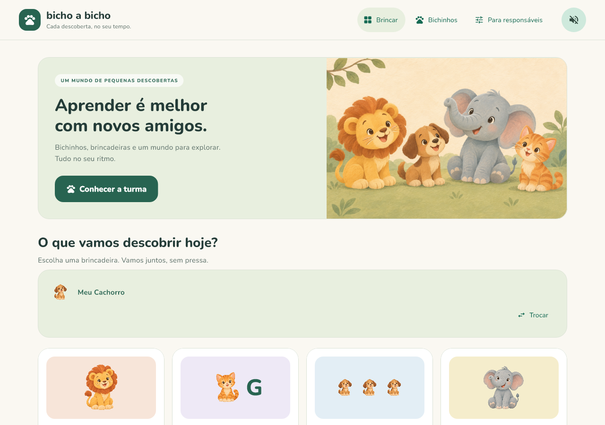
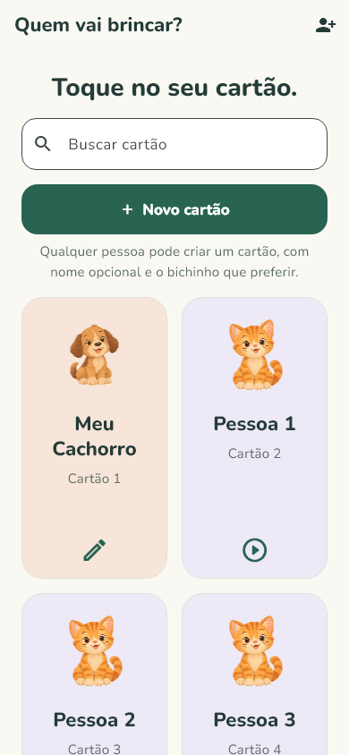
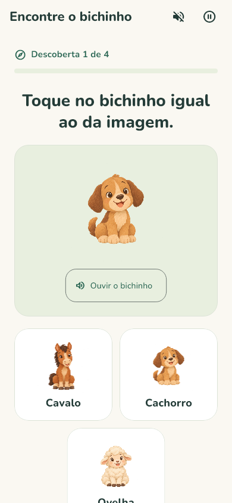
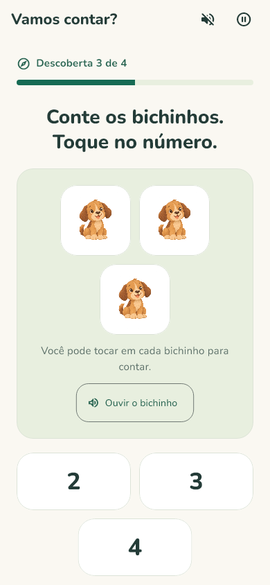
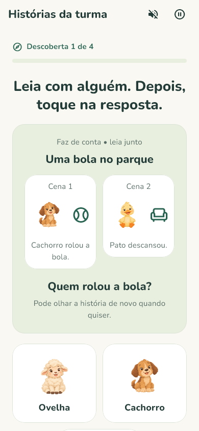
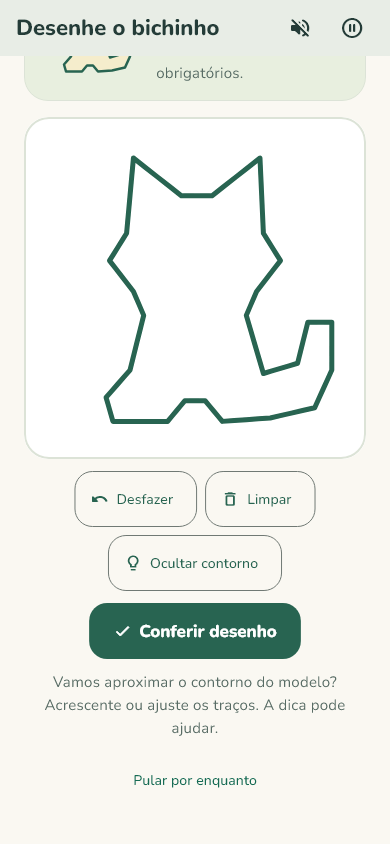
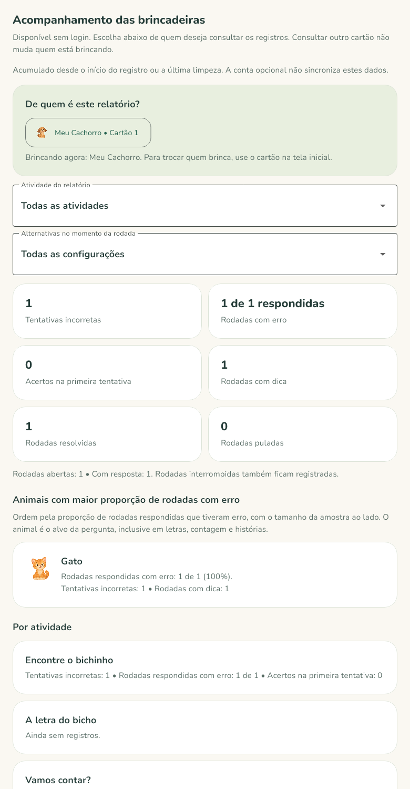

<div align="center">
  

  <h1>Bicho a Bicho</h1>

  <p><strong>Aprender e brincar no seu ritmo.</strong></p>
  <p>Brincadeiras educativas com animais, descobertas e uma experiência que respeita o tempo de cada criança.</p>

  
  
  
  

  <p>
    <a href="#sobre-o-projeto">Sobre</a> ·
    <a href="#atividades">Atividades</a> ·
    <a href="#galeria">Galeria</a> ·
    <a href="#como-executar">Como executar</a> ·
    <a href="#documentação">Documentação</a>
  </p>
</div>



## Sobre o projeto

**Bicho a Bicho** é um aplicativo Flutter em português brasileiro que reúne sete brincadeiras educativas e um catálogo de oito animais com imagens e sons. Associação visual, letras, contagem, fala, pistas, histórias e desenho fazem parte de uma experiência com instruções simples e apoio visual.

O projeto considera previsibilidade, acessibilidade cognitiva e personalização para crianças com Transtorno do Espectro Autista (TEA). Famílias e educadores podem ajustar a experiência e acompanhar registros de uso no próprio dispositivo, sem exigir conta para brincar.

> O aplicativo não é uma avaliação clínica nem um programa pedagógico validado. A relação proposta com a BNCC está documentada, mas não representa validação oficial pelo MEC ou comprovação de eficácia. A adequação das atividades deve ser avaliada com famílias, educadores e crianças.

## Atividades

| Brincadeira | Como funciona |
| --- | --- |
| **Encontre o bichinho** | Associar a imagem ao animal correspondente entre duas ou três alternativas. |
| **A letra do bicho** | Escolher a letra que completa o nome do animal, com alternativas estáveis e opção de ajuda. |
| **Vamos contar?** | Contar grupos de um a quatro animais, marcando cada bichinho ao tocar. |
| **Olá, bichinho!** | Dizer o nome do animal ou responder por toque; as duas formas permitem concluir a atividade. |
| **Detetive dos bichos** | Descobrir qual animal combina com uma pista, com leitura compartilhada. |
| **Histórias da turma** | Acompanhar quatro histórias originais em duas cenas e responder a perguntas por imagens. |
| **Desenhe o bichinho** | Desenhar o contorno de cachorro, gato, leão ou elefante, com modelo, dica tracejada e opção de desfazer. |

Na seção **Bichinhos**, a criança também pode explorar cachorro, gato, leão, elefante, vaca, cavalo, ovelha e pato. As imagens e os sons do catálogo acompanham o aplicativo e estão disponíveis offline.

Pistas e histórias foram pensadas para leitura com um adulto, sem exigir leitura independente. A conferência do desenho usa comparação geométrica local; seus resultados não medem habilidade artística, coordenação motora ou dificuldade clínica. Consulte os [critérios do desenho](docs/DRAWING_GAME.md) e as [referências das atividades](docs/EDUCATIONAL_ACTIVITIES_RESEARCH.md).

## Uma experiência no ritmo da criança

- **Avanço por escolha:** sem cronômetro, punição ou troca automática de rodada.
- **Pausa e apoio:** é possível pedir dica, pular uma rodada ou interromper a atividade.
- **Som sob controle:** sons começam desligados e não há música de fundo contínua.
- **Movimento reduzido:** ativado por padrão, respeitando também a preferência de acessibilidade do sistema.
- **Comemorações breves:** feedback visual de acerto e áudio opcional, interrompidos ao pausar, avançar ou sair.
- **Resposta alternativa:** a atividade de fala também pode ser concluída por toque.
- **Sessões ajustáveis:** responsáveis escolhem a quantidade de alternativas e a duração em rodadas.

A abertura apresenta a turma por cinco segundos e pode ser pulada em **Começar agora**. Ela aparece uma vez por inicialização. Em movimento reduzido, a turma e as comemorações são exibidas sem animação.

## Cartões e acompanhamento

Depois da abertura, cada criança escolhe seu cartão ou cria outro em **Novo cartão**, com animal e nome ou apelido opcional. Na primeira seleção, é possível identificar o cartão ou continuar sem nome. Nas próximas entradas, basta tocar nele; a opção **Trocar** fica na tela inicial.

Não há limite fixo de cartões. A busca e os números individuais ajudam a distinguir cartões com nomes ou animais iguais. A área **Responsáveis** permite editar os cartões, ajustar a experiência e consultar o histórico local de uso, incluindo dicas e rodadas com erro por jogo e por animal.

Esses registros representam interações com as atividades. Não constituem uma avaliação da criança, e sessões concluídas podem incluir rodadas puladas. O histórico permanece no dispositivo, sem sincronização entre aparelhos. Veja as [regras do acompanhamento](docs/PARENT_PROGRESS.md).

## Galeria

<table>
  <tr>
    <td align="center"><strong>Escolha do cartão</strong><br></td>
    <td align="center"><strong>Associação visual</strong><br></td>
    <td align="center"><strong>Contagem</strong><br></td>
  </tr>
  <tr>
    <td align="center"><strong>Histórias da turma</strong><br></td>
    <td align="center"><strong>Desenho</strong><br></td>
    <td align="center"><strong>Acompanhamento</strong><br></td>
  </tr>
</table>

As capturas são geradas pelo renderer do Flutter em testes. Outras telas e tamanhos estão em [docs/previews](docs/previews/).

## Tecnologias e arquitetura

O projeto utiliza **Feature-First + MVVM**, com domínio independente de Flutter onde há regras de negócio. O estado é gerenciado com `ChangeNotifier` e `ListenableBuilder`, e os ViewModels recebem suas dependências por construtor.

| Tecnologia | Uso no projeto |
| --- | --- |
| Flutter e Dart | Interface, navegação e regras das atividades. |
| `flutter_localizations` | Localização em português brasileiro. |
| `shared_preferences` | Preferências, cartões e histórico local com `SharedPreferencesAsync`. |
| `audioplayers` | Sons dos animais e áudio de comemoração. |
| `speech_to_text` | Reconhecimento de voz opcional. |
| Firebase Authentication | Conta opcional para responsáveis. |
| Firebase Analytics | Análise de uso opcional, mediante consentimento. |

```text
lib/
├── app/                 # Composição do app, abertura e fluxo de entrada
├── core/                # Tema, widgets, serviços e contratos de analytics
├── features/
│   ├── account/         # Conta opcional dos responsáveis
│   ├── animals/         # Catálogo e exploração dos animais
│   ├── games/           # Regras, sessões e apresentação dos jogos
│   ├── home/            # Tela inicial
│   ├── opening/         # Apresentação da turma
│   ├── progress/        # Cartões e acompanhamento local
│   └── settings/        # Preferências e área dos responsáveis
├── firebase_options.dart
└── main.dart
```

Serviços de áudio, fala e analytics possuem contratos substituíveis por fakes. A navegação usa `Navigator` e `MaterialPageRoute`. Os detalhes e as decisões estão em [Arquitetura](docs/ARCHITECTURE.md).

## Como executar

### Pré-requisitos

- Flutter **3.47.0 ou superior**.
- Dart **3.12.0 ou superior, anterior à versão 4.0.0**, conforme o `pubspec.yaml`.
- Git e ferramentas da plataforma de destino.

SDK conferido nesta revisão da documentação: **Flutter 3.47.9 / Dart 3.13.7**. O comando `flutter` precisa estar disponível no `PATH`.

### Instalação

```sh
git clone https://github.com/cicerogusta/AnimalGameFlutter.git BichoABicho
cd BichoABicho
flutter pub get
flutter run
```

Para executar no Chrome:

```sh
flutter run -d chrome
```

### Plataformas

| Destino | Requisitos e situação |
| --- | --- |
| **Android** | Android 7.0 / API 24 ou superior; Java 17 e Android SDK/NDK compatíveis com o Flutter. Build debug registrado na documentação de validação. |
| **Web** | Execução com Chrome e build release registrados na documentação de validação. Firebase não está configurado para Web neste repositório. |
| **iOS** | iOS 15.0 ou superior. Compilação exige macOS, Xcode e CocoaPods; validação em máquina Apple pendente. |
| **macOS** | macOS 12.0 ou superior. Compilação exige Xcode e CocoaPods; validação em máquina Apple pendente. |
| **Windows e Linux** | Diretórios de plataforma presentes; builds desktop pendentes de validação. Firebase não está configurado nesses destinos. |

A disponibilidade do reconhecimento de voz depende da plataforma, das permissões e do suporte a pt-BR. Em Windows, builds com plugins podem exigir o Modo de Desenvolvedor para suporte a links simbólicos.

### Firebase

Os jogos não exigem cadastro, e a inicialização do Firebase não bloqueia o acesso às atividades. O repositório mantém configurações de um projeto Firebase existente para Android, iOS e macOS.

Para usar conta e analytics em uma instalação independente, configure seu próprio projeto Firebase e os arquivos de serviço correspondentes. Confira os provedores de autenticação e a ingestão de eventos no console. O adaptador de Analytics do aplicativo está habilitado apenas para Android e iOS; nos demais destinos, a interface informa a indisponibilidade da coleta.

## Qualidade e testes

Execute as verificações a partir da raiz do projeto:

```sh
dart format --output=none --set-exit-if-changed lib test tool
flutter analyze
flutter test
```

Para gerar os builds documentados:

```sh
flutter build web --release
flutter build apk --debug
```

Os testes usam fakes e não dependem de rede, credenciais ou microfone. Cobrem regras das sessões, ViewModels, preferências, cartões, acompanhamento, desenho, consentimento de analytics e interações dos widgets.

O [registro de validação](docs/VALIDATION.md) documenta **162 testes aprovados**, análise estática sem problemas e builds Android debug e Web release concluídos em **5 de novembro de 2026**. Esses resultados pertencem à execução registrada naquele documento; esta revisão do README não reexecutou a suíte.

Para atualizar as capturas de tela em `docs/previews/`:

```sh
flutter test --dart-define=CAPTURE_PREVIEWS=true
```

As capturas não são comparações golden e não substituem inspeção em aparelhos reais.

## Privacidade e dados

- **Identificação opcional:** nenhum nome ou dado pessoal da criança é necessário para brincar.
- **Persistência local:** cartões, preferências e histórico ficam no dispositivo.
- **Analytics por consentimento:** a coleta começa desligada e só é ativada após autorização explícita na área de responsáveis, com registro da versão da política.
- **Escopo da coleta:** quando autorizado, o GA4 recebe eventos futuros de navegação, atividades e ajustes, além de dados automáticos do SDK e um identificador pseudônimo da instalação. O aplicativo não envia nomes, transcrições ou o histórico local retroativamente.
- **Revogação:** desativar a coleta interrompe o envio de eventos do app e redefine dados locais do SDK; não apaga dados já enviados.
- **Voz:** o aplicativo não persiste áudio. O provedor de reconhecimento do sistema ou navegador pode usar internet e processamento externo. A alternativa por toque continua disponível.
- **Desenhos:** os traços ficam em memória durante a rodada e não são persistidos nem enviados ao Analytics.

O catálogo de eventos, o fluxo de consentimento e as instruções de conferência estão em [Analytics](docs/ANALYTICS.md).

### Atenção a instalações anteriores

A versão anterior copiava a senha de cadastro para o Realtime Database. A implementação atual utiliza somente Firebase Authentication e não escreve senhas no banco.

**O administrador do projeto Firebase deve verificar e remover campos de senha legados e avaliar a redefinição das credenciais afetadas.** A correção no aplicativo não remove dados remotos existentes.

## Antes de distribuir

- Validar áudio, microfone, permissões, TalkBack, VoiceOver e conforto sensorial em dispositivos reais e sessões acompanhadas.
- Configurar assinatura de produção no Android: a configuração atual de release utiliza a chave de debug.
- Validar os builds Apple e desktop nas respectivas plataformas.
- Considerar que a área de responsáveis ainda não possui bloqueio parental e o histórico não é sincronizado.
- Conferir configurações Firebase/GA4, consentimento e tratamento dos dados legados.

## Documentação

| Guia | Conteúdo |
| --- | --- |
| [Arquitetura](docs/ARCHITECTURE.md) | Camadas, estado, serviços, persistência e compatibilidade. |
| [Educação e acessibilidade](docs/EDUCATION_AND_ACCESSIBILITY.md) | Intenção pedagógica, referências e limites da proposta. |
| [Pesquisa das atividades](docs/EDUCATIONAL_ACTIVITIES_RESEARCH.md) | Fontes e orientações de mediação. |
| [Desenho](docs/DRAWING_GAME.md) | Modelos, comparação geométrica e limitações. |
| [Acompanhamento](docs/PARENT_PROGRESS.md) | Cartões, contadores e interpretação do relatório. |
| [Analytics](docs/ANALYTICS.md) | Eventos, consentimento, console e DebugView. |
| [Arte e identidade visual](docs/ART_ASSETS.md) | Recursos visuais e prompts. |
| [Animais e áudio](docs/ANIMAL_ASSETS.md) | Origem dos recursos e licenças. |
| [Validação](docs/VALIDATION.md) | Resultados registrados e verificações pendentes. |
| [Nomenclatura do projeto](docs/PROJECT_NAMING.md) | Nome do pacote e preservação dos identificadores existentes. |

## Como contribuir

Sugestões e relatos de problemas podem ser enviados pelas [Issues](https://github.com/cicerogusta/AnimalGameFlutter/issues). Descreva o comportamento observado, os passos para reproduzi-lo e a plataforma utilizada. Evite incluir nomes de crianças ou outros dados pessoais em relatos e capturas.

Para alterações de código, preserve as convenções do projeto, consulte o [AGENTS.md](AGENTS.md), inclua testes proporcionais à mudança e execute as verificações de qualidade antes de abrir um pull request.

## Créditos e licenciamento

A interface utiliza a fonte **Nunito**, cuja licença está em [fonts/OFL-Nunito.txt](fonts/OFL-Nunito.txt). As ilustrações novas foram geradas com ImageGen; os detalhes estão no [guia de arte](docs/ART_ASSETS.md). As fontes e licenças dos sons estão em [Animais e áudio](docs/ANIMAL_ASSETS.md) e em [assets/audio_credits.txt](assets/audio_credits.txt).

O repositório ainda não contém um arquivo de licença geral do código. As licenças dos recursos acima se aplicam aos respectivos materiais.
